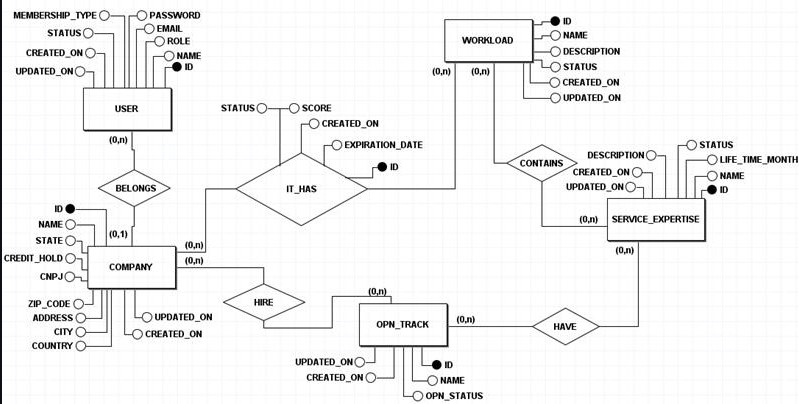

# Lucas Augusto Oliveira de Souza

## Introdução
Meu nome é Lucas Augusto Oliveira de Souza, estudante de Tecnólogo em Banco de Dados com background multidisciplinar em Gestão da Produção Industrial (FATEC) e Pós-Graduação em Administração de Empresas. Minha transição para a área de tecnologia foi motivada por uma sólida aptidão em exatas e pelo interesse em resolver problemas complexos através da programação.

Iniciei minha jornada no desenvolvimento com JavaScript, selecionando esta linguagem devido à sua versatilidade e ampla adoção no mercado de tecnologia. Antes de ingressar na graduação, adquiri conhecimentos fundamentais através de cursos online especializados. Atualmente, no ambiente acadêmico, estou expandindo meu repertório técnico com Python e Java, focando no desenvolvimento de soluções robustas e escaláveis.

## Redes sociais
* [Github](https://github.com/LucasOliveira321)
* [LinkedIn](https://www.linkedin.com/in/lucas-augusto-oliveira/)

## Meus Principais Conhecimentos
Conhecimentos desenvolvidos na FATEC no 5º semestre foram:
<h4>BACKEND</h4>
* Java  
* Spring Boot  
<h4>FRONTEND</h4>
* Javascript  
* VUE  
* CSS  
<h4>BANCO DE DADOS</h4>
* DML - Data Manipulation Language  
* DDL - Data Definition Language  
* DQL - Data Query Language  
* DTL - Data Transaction Language  
* DCL - Data Control Language  
* PL-SQL  
* MYSQL  
<h4>DEVOPS</h4>
* DOCKER
<h4>VERSIONAMENTO DE CÓDIGO</h4>
* GITHUB  
* FLYWAY  

## Portfolio
### 4º Semestre - Oracle Partner Tracker
No primeiro semestre de 2024, a empresa [Oracle](https://www.oracle.com/br/) pediu um programa para controlar as expertise e certificações dos seus parceiros. Assim, teria um acompanhamento das empresas parceiras da Oracle, por meio de graficos para a visualização de dados de forma inteligente, facilitando a identificação de melhorias e de conclusões estratégicas, alem de ter uma visibilidade da performance das empresas parceiras. Para saber mais sobre o projeto visite nosso [Repositório no Github](https://github.com/LukasFernando/FATEC-API-3_Semestre-Dragon).

 Mockup do projeto 

 

 

### Tecnologias Utilizadas
No 4° Semestre as tecnologias usadas foram: 
<h4>BACKEND</h4>
* Java  
* Spring Boot  
<h4>FRONTEND</h4>
* VUE  
* CSS  
* JavaScript  
<h4>BANCO DE DADOS</h4>
* DML - Data Manipulation Language  
* DDL - Data Definition Language  
* DQL - Data Query Language  
* DCL - Data Control Language  
* PL-SQL  
* MYSQL  
<h4>SEGURANÇA</h4>
* JWT (JSON Web Tokens)  
* Spring Security  
* BCrypt  
<h4>VERSIONAMENTO DE CÓDIGO</h4>
* GITHUB  
* FLYWAY  

#### Contribuições Pessoais
* Java Spring Boot. 

 
    Durante o quarto semestre da faculdade, desenvolvi, junto com meu grupo, uma aplicação web utilizando Java Spring Boot. Além das ferramentas já habituais nos projetos anteriores — como DTO, JPA, Spring Security, JWT e Bcrypt — contribuí ativamente na implementação do Flyway, para controle de versões do banco de dados, e do OpenCSV, para importar e exportar dados em formato CSV, ampliando a robustez e a escalabilidade da aplicação. 

* Administração do Banco de Dados. 

 
    Com os conhecimentos adquiridos ao longo do quarto semestre, assumi o papel de Database Administrator (DBA) no início do projeto, aplicando permissões e níveis de acesso de acordo com o perfil de cada usuário do sistema. Essa prática garantiu maior segurança e organização no gerenciamento do banco de dados. 

* PL-SQL. 

 
    Utilizando PL/SQL, contribuí na criação de triggers responsáveis por gerenciar eventos de atualização e upload em determinadas tabelas, registrando automaticamente o histórico de modificações. Essa solução otimizou o desempenho e a integridade dos dados no banco. 

##### Diagrama MER 

### Hard Skills
No quarto semestre do curso, aprofundei meus conhecimentos em gestão e administração de bancos de dados, aplicando permissões de acesso conforme o perfil de cada usuário. Também utilizei PL/SQL para criar triggers responsáveis por monitorar eventos e atualizar tabelas, registrando automaticamente o histórico de alterações — prática que contribuiu para a integridade e rastreabilidade dos dados.
Além disso, participei do desenvolvimento de uma aplicação Java Spring Boot, aplicando boas práticas de organização de pastas, separação de responsabilidades e aproveitando o ecossistema Spring (com JPA, Security, JWT, entre outros) para construir sistemas escaláveis e de alta qualidade.
No frontend, utilizei HTML, CSS e JavaScript puro para consumir a API via requisições HTTP, realizando a administração do token JWT e garantindo a comunicação segura entre cliente e servidor. Essa experiência consolidou minhas habilidades no desenvolvimento de aplicações web dinâmicas e interativas.

### Soft Skills
Durante o quarto semestre, desenvolvi fortemente minhas habilidades de colaboração e comunicação em equipe. Ao mudar de grupo, trabalhei ativamente para alinhar o conhecimento entre os integrantes e estabelecer uma cultura de desenvolvimento cooperativo, promovendo um ambiente de trabalho agradável e produtivo, mesmo exercendo a função de desenvolvedor.
Contribuí também na elaboração de issues que impulsionaram a evolução das regras de negócio e no gerenciamento das demandas do time utilizando ferramentas como GitHub e Jira, fundamentais para a organização, versionamento e acompanhamento das tarefas do projeto.