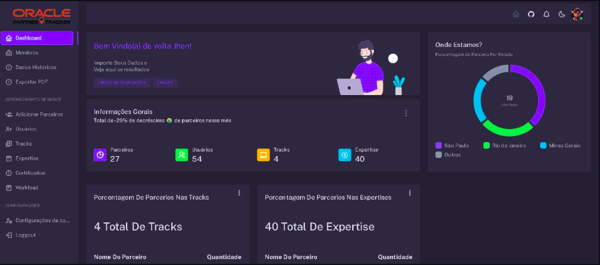

<!--
  Notas de edição (não aparecem no GitHub):
  - O conteúdo de "Contribuições Pessoais" foi levantado a partir dos commits feitos por
    Lucas Oliveira / LucasOliveira321 nos repositórios de cada projeto.
  - Os níveis de proficiência das Hard Skills são uma sugestão inicial: ajuste conforme sua autoavaliação.
-->

<h2>Sobre mim</h2>
<p align="center"></p>

Meu nome é Lucas Augusto Oliveira de Souza, estudante de Tecnólogo em Banco de Dados na FATEC São José dos Campos, com background multidisciplinar em Gestão da Produção Industrial (FATEC) e Pós-Graduação em Administração de Empresas. Minha transição para a área de tecnologia foi motivada por uma sólida aptidão em exatas e pelo interesse em resolver problemas complexos através da programação.

Antes da tecnologia, construí minha carreira na indústria, na TECHFIVE, passando por expedição, Planejamento e Controle da Produção e Gerência de Operações, em que coordenei uma equipe de cerca de 50 pessoas nos setores de produção, expedição, logística interna, transporte e manutenção. Nesse período, trabalhei com sistemas ERP, indicadores (KPIs) e manutenção das normas ISO 9001 e ISO 14001, propondo melhorias nos sistemas para tornar os processos mais eficientes. Essa vivência me deu uma visão de negócio que hoje aplico no desenvolvimento de software.

Iniciei minha jornada no desenvolvimento com JavaScript, escolhendo a linguagem pela sua versatilidade e ampla adoção no mercado. Antes de ingressar na graduação, adquiri os fundamentos através de cursos online. Ao longo do curso, desenvolvi seis projetos integradores (API — Aprendizagem por Projetos Integrados) com empresas parceiras, passando por Python, Java (JavaFX e Spring Boot), Vue, React com TypeScript, bancos relacionais e não relacionais, Docker e Machine Learning.

Desde janeiro de 2024 atuo como Desenvolvedor Fullstack na Ecomni, onde projetei e construí uma arquitetura de microsserviços com 8 APIs RESTful stateless em Python/Flask e SQLAlchemy, protegidas com JWT e cookies de autorização. Uma dessas APIs funciona como proxy e camada AAA (autenticação, autorização e auditoria) na frente das outras sete, e o ecossistema é orquestrado com Kubernetes. Também desenvolvi 5 front-ends em React, TypeScript e Ant Design que consomem essas APIs, além de modelar e otimizar bancos PostgreSQL e manter as aplicações em ambiente de nuvem.

## Contatos
* [GitHub](https://github.com/LucasOliveira321)
* [LinkedIn](https://www.linkedin.com/in/lucas-augusto-oliveira/)

## Meus Principais Conhecimentos

**Aplicações e dados**


## Meus Projetos

| Semestre | Período | Projeto | Empresa Parceira | Papel |
|---|---|---|---|---|
| 1º | 2022-2 | Avaliação 360° | FATEC (projeto interno) | Desenvolvedor |
| 2º | 2023-1 | Controle de Jornada (Desktop) | 2RP | Desenvolvedor |
| 3º | 2023-2 | Controle de Jornada (Web) | 2RP | Desenvolvedor |
| 4º | 2024-1 | Oracle Partner Tracker | Oracle | Desenvolvedor |
| 5º | 2024-2 | RecruitDash | Pro4Tech | Product Owner |
| 6º | 2025-1 | FloraTrack | Kersys | Desenvolvedor |

---

### Em 2022-2

## Sistema de Avaliação 360°

### Empresa Parceira: FATEC (Projeto Interno)

### Problema:
A empresa fictícia PBLTeX, representada pelos professores da FATEC (P2 como cliente e Scrum Master), precisava de uma forma de realizar uma dinâmica de Avaliação Democratizada baseada na técnica de avaliação 360°, em que os integrantes de cada time avaliam os colegas e a si mesmos, de forma anônima, ao final de cada sprint. Era necessário controlar usuários, turmas, times e sprints, e apresentar os resultados em dashboards.

### Solução Entregue pela Equipe:
A equipe Falcon desenvolveu uma aplicação desktop em Python em que cada integrante realiza a autoavaliação e avalia os colegas a cada sprint. O sistema possui controle de acesso por cargo (administrador, instrutor, líder, integrante e fake client), cadastros de turmas, times, sprints e usuários, e dashboards com os resultados consolidados. A primeira versão foi construída com PySimpleGUI e, ao longo do semestre, a interface foi migrada para HTML, CSS e JavaScript integrados ao Python por meio da biblioteca Eel, com os dados persistidos em arquivos JSON.

[Repositório do Projeto](https://github.com/lucasjonathangomes/Falcon)

#### Tecnologias Utilizadas
> - **Python**: Linguagem do back-end, responsável pelas regras de negócio, pelo cadastro e pela leitura e gravação dos dados.
> - **PySimpleGUI**: Biblioteca usada na primeira versão da interface gráfica (login, cadastro e avaliação).
> - **Eel**: Biblioteca que expõe funções Python para o JavaScript, permitindo usar HTML, CSS e JavaScript como interface de uma aplicação desktop.
> - **HTML, CSS e JavaScript**: Interface da segunda versão, com telas de cadastro, avaliação e gráficos.
> - **Chart.js**: Biblioteca de gráficos usada nos dashboards por sprint.
> - **JSON**: Armazenamento dos usuários, turmas, times e avaliações.
> - **Git e GitHub**: Versionamento do código e colaboração da equipe.

#### Contribuições Pessoais

<details>
  <summary>Primeira versão das telas em PySimpleGUI</summary>
  <br>
Desenvolvi a primeira versão da tela de login, da tela de cadastro de usuários e da tela de avaliação usando PySimpleGUI, incluindo a lógica de cadastro com gravação em JSON. Depois, adaptei a tela de avaliação ao novo layout definido pela equipe, com os botões de confirmar e cancelar e os campos de seleção do integrante avaliado.
</details>

<details>
  <summary>Integração entre JavaScript e Python com Eel</summary>
  <br>
Na migração para a interface web, fiz a ligação entre os botões das telas HTML e as funções Python expostas pelo Eel. Na tela de cadastro, cada formulário (turma, time, sprint e usuário) chama a função <code>Cadastrar</code> do back-end e informa ao usuário se o cadastro foi feito ou se o registro já existia:

```javascript
function cad(){
    let a = document.getElementById("cadastrar-turma").value;
    eel.Cadastrar('turma', {'Turma': a});
    document.getElementById("cadastrar-turma").value = "";
    ...
}
```

Também implementei a navegação entre as telas (botões de voltar, abertura de um formulário por vez na janela de cadastro) e a captura do valor dos campos <code>radio</code> na tela de avaliação.
</details>

<details>
  <summary>Controle de acesso por cargo</summary>
  <br>
Implementei a validação do nível de acesso no front-end: ao clicar em um botão de cadastro, o JavaScript busca no Python as informações do usuário logado e só libera a funcionalidade para os cargos permitidos. No formulário de cadastro de usuário, os campos exibidos mudam de acordo com o cargo selecionado (por exemplo, um "Fake Client" não é vinculado a um time):

```javascript
function ValidaAcesso(id){
    eel.Retorna_info('user')(function(userInfo){
        let usuarioAcesso = userInfo['Cargo'];
        if(id == 'cdTurma' || id == 'cdUsuario' || id == 'cdSprint' && usuarioAcesso == 'Instrutor'){
            EsconderElementos(id);
        }else{
            window.alert('Você não tem acesso!')
        }
    });
}
```
</details>

<details>
  <summary>Backlog, User Stories e dashboards</summary>
  <br>
Elaborei a planilha de Backlog do Produto com as User Stories da equipe e mantive o README do projeto atualizado ao longo das sprints. No fim do semestre, criei a tela de gráficos com Chart.js, que apresenta os resultados das avaliações por sprint.
</details>

#### Hard Skills

- **Python**: Sei fazer com ajuda
- **HTML, CSS e JavaScript**: Sei fazer com autonomia
- **Manipulação de dados com JSON**: Sei fazer com autonomia
- **Git/GitHub**: Sei fazer com ajuda

#### Soft Skills

**Colaboração**: Como eu já tinha estudado JavaScript antes do curso, apoiei os colegas na migração da interface para HTML e JavaScript, principalmente na comunicação entre o front-end e as funções em Python.

**Organização**: Mesmo sem ser o Scrum Master, ajudei a equipe a distribuir as demandas de forma mais direcionada, atribuindo cada tarefa a um desenvolvedor específico. Com responsabilidades claras, evitamos retrabalho e a equipe ganhou produtividade ao longo das sprints.

---

### Em 2023-1


## Controle de Jornada — Horas Extras e Sobreavisos (Desktop)

### Empresa Parceira: [2RP](https://2rpnet.com.br/)

### Problema:
A empresa enfrentava dificuldades na gestão das horas extras e dos sobreavisos dos colaboradores. O registro e a aprovação eram manuais, lentos e sujeitos a erros, o que atrasava o pagamento e não oferecia uma visão centralizada para os gestores.

### Solução Entregue pela Equipe:
A equipe Dragon desenvolveu um software desktop em Java para controle de jornada. O colaborador registra suas horas extras e sobreavisos, informando equipe, cliente e justificativa; o gestor visualiza e aprova ou reprova os lançamentos da sua equipe; e o administrador cadastra usuários, equipes, clientes e os relacionamentos entre eles. O sistema também oferece consultas, um dashboard e a exportação dos apontamentos em CSV.

[Repositório do Projeto](https://github.com/dragonfatec/projeto2023)

<div> Mockup do projeto </div>
<details>

https://user-images.githubusercontent.com/111617449/229277325-9ba27ca7-5a0c-4368-9787-75d5b2127dc4.mp4

</details>

#### Tecnologias Utilizadas
> - **Java**: Linguagem do sistema, com as regras de negócio e a camada de acesso a dados.
> - **JavaFX**: Framework de interfaces gráficas usado para construir as telas (FXML e controllers).
> - **CSS**: Estilização das telas JavaFX.
> - **PostgreSQL**: Banco de dados relacional da aplicação.
> - **JDBC**: API de conexão entre Java e o PostgreSQL.
> - **Git e GitHub**: Versionamento do código e colaboração da equipe.

#### Contribuições Pessoais

<details>
  <summary>Camada de acesso a dados com JDBC (ConnectionFactory)</summary>
  <br>
Fui o principal responsável pela classe <code>ConnectionFactory</code>, que centraliza a conexão com o PostgreSQL e todas as operações SQL do sistema. Nela implementei os métodos de cadastro (usuário, equipe, cliente), o apontamento de horas, os relacionamentos N:N entre equipe e usuário e entre equipe e cliente, a atualização de status de aprovação, a validação do login e as consultas usadas pelas telas:

```java
public void apontarHoras(String matricula, String data_inicial, String data_final, String equipe,
                         String tipo_hora, String justificativa, String cliente){
    runAtualizar(String.format("INSERT INTO hora (matricula, data_hora_inicial, data_hora_final, justificativa, " +
        "id_equipe, tipo_hora, id_cliente, status) VALUES ('%s','%s','%s','%s',%s,'%s',%s,'Em andamento');", ...));
}
```

Ao longo do semestre, fui refatorando essa classe e ajustando as telas que dependiam dela, para que todo o acesso ao banco passasse por um único ponto.
</details>

<details>
  <summary>Telas de registro e aprovação de horas</summary>
  <br>
Conectei as telas JavaFX ao banco de dados. Na tela de <b>Registrar Hora</b>, os <code>ChoiceBox</code> de equipe e cliente são preenchidos a partir do banco, e o botão confirmar grava o apontamento. Na tela de <b>Aprovar Hora</b>, implementei a busca das horas da equipe de acordo com o cargo do usuário logado, garantindo que o gestor não aprove as próprias horas.
</details>

<details>
  <summary>Tela de administração, dashboard e exportação CSV</summary>
  <br>
Desenvolvi as funcionalidades da tela de Admin: cadastro de equipes e clientes, vínculo de usuários e clientes às equipes e ordenação dos usuários por equipe. Também escrevi as consultas SQL do dashboard e o método <code>getInfoCSV</code>, que reúne os apontamentos de um colaborador para exportação em CSV.
</details>

<details>
  <summary>Script do banco de dados</summary>
  <br>
Mantive atualizados os scripts DDL e DML do banco <code>controle-de-ponto</code> conforme a modelagem evoluía durante as sprints.
</details>

##### Diagrama MER
<details>


</details>

#### Hard Skills

- **Java (POO)**: Sei fazer com autonomia
- **JavaFX**: Sei fazer com ajuda
- **JDBC e SQL (DDL, DML, DQL)**: Sei fazer com autonomia
- **PostgreSQL**: Sei fazer com ajuda

#### Soft Skills

**Responsabilidade**: Como a camada de banco era usada por todas as telas, assumi a tarefa de mantê-la estável e de ajustar as classes dos colegas a cada mudança, para que a equipe não ficasse bloqueada.

**Comunicação**: Para criar o script SQL, eu precisava de um modelo de dados definido. No início do semestre, conduzi o alinhamento da equipe na construção do MER e, com ele aprovado, entreguei o script do banco, o que destravou as entregas dos colegas que dependiam das tabelas.

**Aprendizado contínuo**: Montar as consultas concatenando strings funcionou para a entrega, mas mostrou na prática a importância de consultas parametrizadas e de frameworks de persistência, que passei a usar no semestre seguinte com JPA.

---

### Em 2023-2


## Controle de Jornada — Horas Extras e Sobreavisos (Web)

### Empresa Parceira: [2RP](https://2rpnet.com.br/)

### Problema:
O problema era o mesmo do semestre anterior, com uma nova necessidade: o sistema precisava ser acessado pela web, com autenticação segura e controle de acesso por perfil (colaborador, gestor e administrador), além de gerar os dados para o pagamento das horas.

### Solução Entregue pela Equipe:
A equipe reconstruiu o sistema como uma aplicação web, com uma API REST em Java Spring Boot e um front-end em HTML, CSS e JavaScript. O colaborador aponta suas horas extras e sobreavisos; o gestor aprova ou reprova os lançamentos dos centros de resultado (CR) sob sua responsabilidade; e o administrador cadastra usuários, clientes e CRs e os vincula entre si. O sistema também exporta os apontamentos para Excel, já com as verbas de pagamento calculadas.

[Repositório do Projeto](https://github.com/dragonfatec/Projeto-web)

<div> Mockup do projeto </div>
<details>

 

</details>

#### Tecnologias Utilizadas
> - **Java e Spring Boot**: API REST com arquitetura em camadas (controller, service, repository).
> - **Spring Data JPA / Hibernate**: Mapeamento objeto-relacional e consultas ao banco.
> - **MySQL**: Banco de dados relacional da aplicação.
> - **Spring Security, JWT e BCrypt**: Autenticação stateless por token e criptografia de senhas.
> - **Swagger (springdoc-openapi)**: Documentação dos endpoints.
> - **Aspose Cells**: Geração das planilhas Excel.
> - **HTML, CSS e JavaScript**: Front-end que consome a API com a Fetch API.
> - **Docker Compose**: Containers do front-end (Nginx) e do MySQL.
> - **Git, GitHub e Jira**: Versionamento e gestão das tarefas.

#### Contribuições Pessoais

<details>
  <summary>Estrutura inicial do projeto Spring Boot</summary>
  <br>
Criei o projeto Spring Boot, a estrutura de pastas e a configuração do <code>application.properties</code>, além das primeiras entidades (Usuário, Cliente, Centro de Resultado e apontamento de horas), DTOs com <code>record</code> e os controllers e services de usuário, cliente e CR. Essa base serviu de modelo para o restante da equipe.
</details>

<details>
  <summary>Segurança com Spring Security, JWT e BCrypt</summary>
  <br>
Implementei a camada de segurança da API. O login gera um token JWT, as senhas são armazenadas com BCrypt e a sessão é <i>stateless</i>. Criei o filtro que lê o token do header <code>Authorization</code> em cada requisição e autentica o usuário no contexto do Spring:

```java
@Override
protected void doFilterInternal(HttpServletRequest request, HttpServletResponse response,
                                FilterChain filterChain) throws ServletException, IOException {
    var tokenJWT = recoverTocken(request);
    if(tokenJWT != null){
        var subject = tokenService.getSubject(tokenJWT);
        var user = userRepository.findByEmail(subject);
        var authentication = new UsernamePasswordAuthenticationToken(user, null, user.getAuthorities());
        SecurityContextHolder.getContext().setAuthentication(authentication);
    }
    filterChain.doFilter(request, response);
}
```

No front-end, passei o token como <i>Bearer</i> em todas as requisições e guardei o cargo do usuário para exibir apenas as funcionalidades permitidas, com a validação dos cargos também feita na API.
</details>

<details>
  <summary>Separação entre front-end e back-end com Docker Compose</summary>
  <br>
O front-end começou como templates Thymeleaf dentro da API. Fiz a refatoração que separou o front-end em um projeto próprio (HTML, CSS e JavaScript) consumindo a API REST, e criei um <code>docker-compose.yml</code> com um container Nginx para servir o front e um container MySQL com volume persistente, o que resolveu os problemas de CORS no navegador.
</details>

<details>
  <summary>Telas e regras de negócio de apontamento e aprovação</summary>
  <br>
Desenvolvi as telas de apontamento de horas, de consulta dos apontamentos e de aprovação, consumindo a API. No back-end, apliquei as regras de negócio nas consultas de horas e implementei a edição de usuários, clientes e CRs e a exclusão dos relacionamentos entre eles.
</details>

<details>
  <summary>Exportação para Excel com cálculo de verbas</summary>
  <br>
Implementei a exportação dos apontamentos para Excel com a biblioteca Aspose Cells. A planilha traz data inicial e final, tipo de hora, CR, colaborador, cliente, justificativa, status e as colunas das verbas de pagamento usadas pela 2RP (1601, 1602, 809, 3000 e 3001), com cabeçalho formatado e estilos por status.
</details>

##### Diagrama MER
<details>


</details>

#### Hard Skills

- **Java e Spring Boot**: Sei fazer com autonomia
- **Spring Data JPA**: Sei fazer com autonomia
- **Spring Security, JWT e BCrypt**: Sei fazer com autonomia
- **JavaScript (Fetch API) e HTML/CSS**: Sei fazer com autonomia
- **MySQL**: Sei fazer com autonomia
- **Docker Compose**: Sei fazer com ajuda

#### Soft Skills

**Proatividade**: Iniciei a estrutura do projeto antes da primeira sprint para que a equipe tivesse um padrão a seguir desde o começo.

**Iniciativa**: Propus separar o front-end do back-end por ser a prática mais adotada no mercado para APIs RESTful, e usei Docker para padronizar o ambiente. Como a equipe tinha pouca experiência com Docker, a mudança assustou no começo; apoiei os colegas na configuração e, com o tempo, todos se acostumaram e passaram a trabalhar com o mesmo ambiente, sem os problemas de CORS que tínhamos antes.

---

### Em 2024-1


## Oracle Partner Tracker

### Empresa Parceira: [Oracle](https://www.oracle.com/br/)

### Problema:
A Oracle tinha dificuldade para acompanhar e analisar os dados das empresas parceiras no OPN (Oracle PartnerNetwork), como as trilhas (tracks), expertises e certificações de cada parceiro. Sem uma plataforma moderna, era difícil visualizar a evolução dos parceiros e tomar decisões estratégicas.

### Solução Entregue pela Equipe:
A equipe CodeCatss desenvolveu o Oracle Partner Tracker, uma plataforma web para cadastrar e acompanhar as empresas parceiras, suas tracks, expertises, workloads e certificações. O sistema importa dados via CSV, apresenta dashboards com indicadores (parceiros por estado, por track e por expertise, evolução mensal) e exporta relatórios em PDF.

[Repositório do Projeto](https://github.com/codecatss/API-BD4) · [Back-end](https://github.com/codecatss/backend-spring-API4) · [Front-end](https://github.com/codecatss/frontend-vue-API4)

<div> Mockup do projeto </div>
<details>




</details>

#### Tecnologias Utilizadas
> - **Java e Spring Boot**: API REST do sistema.
> - **Spring Data JPA e JPQL**: Persistência e consultas agregadas para os dashboards.
> - **Oracle Database e PL/SQL**: Banco de dados relacional, com permissões por perfil e triggers.
> - **Flyway**: Versionamento do esquema do banco de dados.
> - **OpenCSV**: Importação de dados em CSV.
> - **iText**: Geração de relatórios em PDF.
> - **Spring Security e JWT**: Autenticação e autorização.
> - **Vue.js**: Front-end da aplicação.
> - **Git, GitHub e Jira**: Versionamento e gestão das tarefas.

#### Contribuições Pessoais

<details>
  <summary>Endpoint e consultas do Dashboard com JPQL</summary>
  <br>
Criei o <code>DashboardController</code>, o <code>DashboardService</code> e os DTOs do dashboard, com o endpoint que retorna os KPIs da tela inicial. Para os gráficos, escrevi consultas JPQL que já devolvem DTOs prontos para o front-end usando <i>constructor expressions</i>:

```java
@Query("select new Oracle.Partner.Tracker.dto.StatePerCompany(c.state, COUNT(c.state) as companyCount) " +
       "from Company c GROUP BY c.state")
List<StatePerCompany> getCompaniesByState();

@Query("SELECT new Oracle.Partner.Tracker.dto.TrackPerCompany(o.name, COUNT(DISTINCT c.id)) FROM Company c " +
       "LEFT JOIN c.companyOpnTrack co LEFT JOIN co.opnTrack o GROUP BY o.name")
List<TrackPerCompany> getTrackPerCompany();
```
</details>

<details>
  <summary>Modelagem dos relacionamentos entre as entidades</summary>
  <br>
Implementei os relacionamentos N:N do domínio como entidades de associação (<code>CompanyOpnTrack</code>, <code>OpnTrackExpertise</code>, <code>ExpertiseCertification</code>, <code>WorkloadExpertise</code> e <code>UserCertification</code>), ajustei o <code>ddl.sql</code> e reorganizei os enums do projeto (status, OPN status, roles e operações de ingestão). Também criei o script DML com dados de exemplo e atualizei a documentação do banco em português e inglês.
</details>

<details>
  <summary>Cadastro de empresas e expertises</summary>
  <br>
No back-end, implementei os endpoints POST de empresas e expertises usando <code>record</code> como DTO de entrada. No front-end em Vue, desenvolvi a tela de CRUD de empresas, com a tabela de listagem e o formulário de cadastro, e criei utilitários que preenchem o endereço pelo CEP (ViaCEP) e os dados da empresa pelo CNPJ (ReceitaWS):

```javascript
async function get_address_by_cep(cep){
    const response = await fetch(`https://viacep.com.br/ws/${cep}/json/`);
    const data = await response.json();
    return data;
}
```
</details>

<details>
  <summary>Exportação de relatório em PDF</summary>
  <br>
Implementei a exportação do dashboard em PDF com a biblioteca iText, gerando o documento no back-end e disponibilizando o download no menu lateral do front-end.
</details>

<details>
  <summary>Administração do Banco de Dados</summary>
  <br>
No início do projeto, assumi o papel de Database Administrator (DBA). Criei os usuários do banco e apliquei as permissões e os níveis de acesso de acordo com o perfil de cada usuário do sistema, garantindo mais segurança e organização no gerenciamento dos dados. Essas configurações foram feitas diretamente no servidor de banco de dados, por isso não aparecem no histórico do repositório.
</details>

<details>
  <summary>PL/SQL: triggers para histórico de alterações</summary>
  <br>
Utilizando PL/SQL no Oracle Database, criei triggers que monitoram os eventos de atualização e de carga (upload) em tabelas do sistema e registram automaticamente o histórico das modificações. Assim, o banco mantém a rastreabilidade das mudanças sem depender da aplicação, preservando a integridade dos dados. Assim como a parte de permissões, essas triggers foram criadas diretamente no banco.
</details>
##### Diagrama MER
<details>


</details>

#### Hard Skills

- **Java e Spring Boot**: Sei fazer com autonomia
- **JPQL e consultas agregadas**: Sei fazer com autonomia
- **Modelagem relacional (N:N, entidades associativas)**: Sei fazer com autonomia
- **Oracle Database e PL/SQL (usuários, permissões e triggers)**: Sei fazer com autonomia
- **Vue.js**: Sei fazer com ajuda
- **Geração de PDF com iText**: Sei fazer com ajuda

#### Soft Skills

**Adaptabilidade**: Neste semestre mudei de grupo e passei a trabalhar com o Laroy e com novos colegas. Como o time era novo, todos estavam abertos a sugestões e opiniões, o que facilitou minha adaptação ao padrão do projeto e a resolução dos conflitos de merge entre as entidades, que estavam travando a equipe.

**Colaboração**: Mantive a documentação do banco atualizada em português e inglês para que todos os integrantes entendessem o modelo de dados.

---

### Em 2024-2


## RecruitDash

### Empresa Parceira: [Pro4Tech](https://pro4tech.com.br/)

### Problema:
A empresa tinha dificuldade para acompanhar e analisar os dados do processo de recrutamento e seleção. Sem uma plataforma centralizada, informações como número de candidatos, tempo médio de contratação e custos ficavam dispersas, dificultando decisões rápidas e a identificação de padrões que poderiam tornar o processo mais eficiente.

### Solução Entregue pela Equipe:
A equipe Localhost:305 desenvolveu um dashboard interativo que centraliza os dados de recrutamento e seleção. Um processo de ETL em Python carrega os dados das planilhas da empresa no banco; a API em Spring Boot disponibiliza os indicadores; e o front-end em React apresenta métricas como tempo médio de contratação, contratações e retenção, com filtros, importação de planilhas, exportação em PDF e Excel e controle de acesso por cargos e permissões.

[Repositório do Projeto](https://github.com/Localhost-305/LocalHost305) · [Back-end](https://github.com/Localhost-305/localhost-backend) · [Front-end](https://github.com/Localhost-305/localhost-frontend) · [Banco de dados](https://github.com/Localhost-305/localhost-database)

<div> Mockup do projeto </div>
<details>

[Screencast from 2024-09-29 22-07-52.webm](https://github.com/user-attachments/assets/030b4637-d812-46d1-9c0b-a8343941f8b8)

</details>

#### Tecnologias Utilizadas
> - **Java e Spring Boot**: API REST com os indicadores do dashboard.
> - **Spring Security e JWT**: Autenticação e autorização por cargos e permissões.
> - **MySQL e Flyway**: Banco de dados relacional e versionamento das migrations.
> - **React, TypeScript e Vite**: Front-end da aplicação.
> - **Ant Design, Styled Components e Redux**: Componentes visuais, estilização e estado global.
> - **Python**: Processo de ETL das planilhas da empresa.
> - **Docker e GitHub Actions**: Containers e pipeline de CI/CD da equipe.
> - **Git, GitHub e Jira**: Versionamento e gestão do backlog.

#### Contribuições Pessoais

<details>
  <summary>Atuei como Product Owner</summary>
  <br>
Além de entender as demandas do cliente e transformá-las em User Stories no Jira, usei a experiência de desenvolvimento dos semestres anteriores para detalhar as tarefas tecnicamente, com critérios de aceitação claros e a estrutura de retorno das APIs. Isso permitiu que o time de front-end simulasse os dados e avançasse sem depender da conclusão do back-end. Também mantive o README do projeto atualizado a cada sprint.
</details>

<details>
  <summary>Base de desenvolvimento para a equipe</summary>
  <br>
Antes da primeira sprint, criei a organização dos repositórios (com submódulos para back-end, front-end e banco) e uma base técnica para cada um:
<ul>
  <li><b>Back-end</b>: projeto Spring Boot com exemplos das camadas (entity, DTO, repository, service e controller), Spring Security com JWT, BCrypt, CORS e Swagger.</li>
  <li><b>Front-end</b>: projeto React + TypeScript + Vite organizado em módulos, com componentes reutilizáveis (inputs com máscara de CPF, CNPJ, telefone e CEP, tabela, menu, header), hooks de requisição e notificação e store Redux.</li>
  <li><b>Banco de dados</b>: script SQL inicial do modelo.</li>
</ul>
Com essa base, cada integrante pôde seguir o mesmo padrão desde o início.
</details>

<details>
  <summary>Funcionalidades do dashboard</summary>
  <br>
Desenvolvi no front-end o card de tempo médio de contratação, o filtro dos gráficos, o filtro da tabela e a importação de planilhas <code>.xlsx</code>. Na reta final, refatorei a tela do dashboard e integrei os botões de exportação em PDF e Excel aos endpoints da API.
</details>

<details>
  <summary>Gestão de cargos e permissões</summary>
  <br>
Implementei a alteração de cargo dos usuários, com a migration Flyway que cria os cargos e, no front-end, o mapeamento das permissões do sistema (adicionar cargo, editar usuário, importar dados, visualizar dados e visualizar dados financeiros), usadas para exibir apenas o que cada perfil pode acessar.
</details>

##### Diagrama MER
<details>


</details>

#### Hard Skills

- **Gestão de backlog e User Stories (Jira)**: Sei fazer com autonomia
- **Java e Spring Boot**: Sei fazer com autonomia
- **React com TypeScript**: Sei fazer com autonomia
- **Arquitetura de projetos (estrutura base front-end e back-end)**: Sei fazer com autonomia
- **Docker**: Sei fazer com ajuda

#### Soft Skills

**Liderança colaborativa**: Como Product Owner, distribuí as tarefas de acordo com as aptidões e o interesse de cada integrante. Com parte do grupo vindo do semestre anterior, atuei na transmissão de conhecimento para os novos membros.

**Comunicação**: Detalhar as User Stories com o contrato das APIs reduziu as dependências entre front-end e back-end e os bloqueios durante as sprints.

**Foco no cliente**: Durante as validações, o cliente pediu mudanças na interface para visualizar melhor o dashboard, além da exportação de relatórios em Excel e PDF. Repriorizei o backlog para incluir essas demandas, criei as tarefas com a equipe e participei da refatoração da tela e da integração das exportações, entregando o que o cliente precisava ainda dentro do semestre.

---

### Em 2025-1


## FloraTrack

### Empresa Parceira: [Kersys](https://kersys.com.br/)

### Problema:
Não existia uma solução centralizada para o monitoramento e a gestão de áreas reflorestadas. Sem ferramentas que integrassem dados de saúde das árvores, captura de CO₂, qualidade do solo, biodiversidade e financiamento, as decisões estratégicas ficavam prejudicadas. Era necessário usar Inteligência Artificial para analisar esses dados, prever tendências e indicar as práticas com maior chance de sucesso.

### Solução Entregue pela Equipe:
A equipe Localhost:308 desenvolveu uma plataforma de gestão de áreas reflorestadas. As empresas responsáveis enviam os dados mensais de cada área, que ficam armazenados para acompanhar a evolução ao longo do tempo. A API em Flask combina PostgreSQL (dados cadastrais) e MongoDB (grande volume de registros de acompanhamento), e o front-end em React apresenta dashboards, a importação de arquivos CSV e uma tela de insights com Machine Learning, que prevê a saúde das árvores e aponta as práticas associadas a uma alta taxa de sobrevivência. A plataforma também atende à LGPD, com termos de uso versionados e criptografia dos dados pessoais.

[Repositório do Projeto](https://github.com/Localhost-308/API-BD6) · [Back-end](https://github.com/Localhost-308/server) · [Front-end](https://github.com/Localhost-308/client)

<div> Mockup do projeto </div>
<details>

https://github.com/user-attachments/assets/b31513f2-7300-4c2a-9eef-77439e0d104b

https://github.com/user-attachments/assets/58ae0a9d-3960-439f-8e10-f8648e28d2bb

</details>

#### Tecnologias Utilizadas
> - **Python e Flask**: API REST, com SQLAlchemy (ORM), Marshmallow (serialização) e Flask-JWT-Extended.
> - **PostgreSQL**: Banco relacional dos dados cadastrais.
> - **MongoDB**: Banco não relacional dos registros mensais das áreas.
> - **Pandas, scikit-learn e mlxtend**: Preparação dos dados, modelo preditivo e regras de associação.
> - **React, TypeScript e Vite**: Front-end da aplicação.
> - **Ant Design e ECharts**: Componentes visuais e gráficos interativos.
> - **Docker e Docker Compose**: Containers da API, do PostgreSQL e do MongoDB.
> - **Git, GitHub e Jira**: Versionamento e gestão das tarefas.

#### Contribuições Pessoais

<details>
  <summary>Base do back-end em Flask com Docker</summary>
  <br>
Criei a estrutura inicial da API em Flask: configuração, inicialização da aplicação, models com SQLAlchemy, schemas com Marshmallow, o primeiro controller (usuários) e o <code>Dockerfile</code> e <code>docker-compose.yml</code> com a API e o PostgreSQL. Depois, adicionei o MongoDB ao compose e configurei a conexão, criando a arquitetura híbrida usada pelo restante da equipe.
</details>

<details>
  <summary>Machine Learning: previsão da saúde das árvores e regras de associação</summary>
  <br>
Treinei um modelo de regressão logística (classificação binária) com o scikit-learn, fora do repositório, a partir de uma planilha que a equipe gerou com os dados das áreas plantadas. Para enriquecer a base, foram incorporados dados históricos do INMET (Instituto Nacional de Meteorologia), como índice pluviométrico e radiação solar, relacionados ao mês do plantio. A variável alvo foi definida pela taxa de sobrevivência das árvores (árvores vivas sobre árvores plantadas): áreas com mais de 70% de sobrevivência foram consideradas um ambiente propício (resultado 1) e as demais, não propício (resultado 0).
<br><br>
Implementei também os endpoints de Machine Learning e a tela de insights do front-end. O primeiro endpoint carrega o modelo treinado (<code>model_v2.pkl</code>) e o seu scaler, aplica <i>one-hot encoding</i> nas variáveis categóricas (fontes de água, manejo de pragas, adubação, irrigação, ameaças ambientais, estágio e qualidade da água) e devolve a previsão para a área informada.
<br><br>
O segundo endpoint usa o algoritmo <b>Apriori</b> para encontrar as combinações de práticas mais frequentes nas áreas com taxa de sobrevivência acima de 70%:

```python
df['high_survival'] = df['tree_survival_rate'] > 70
high_survival_practices = df[df['high_survival']][
    ['water_sources', 'pest_management', 'fertilization', 'irrigation', 'environmental_threats']
]
practices_dummies = pd.get_dummies(high_survival_practices)

frequent_itemsets = apriori(practices_dummies, min_support=0.05, use_colnames=True)
rules = association_rules(frequent_itemsets, metric="confidence", min_threshold=0.5)
```

Com isso, o planejador consegue simular um cenário de plantio e ver quais práticas têm maior relação com o sucesso do reflorestamento.
</details>

<details>
  <summary>Termos e Condições versionados (LGPD)</summary>
  <br>
Implementei o versionamento dos Termos e Condições de Uso. O administrador cadastra ou edita o texto, e cada alteração gera uma nova versão (data + sequencial), que pode ser marcada como obrigatória. O aceite do usuário é registrado com a versão, o IP e o <i>user agent</i>, e um endpoint verifica se o usuário já aceitou a versão vigente. Caso não tenha aceitado, o front-end exige a reconfirmação antes de liberar o acesso, garantindo um registro auditável em conformidade com a LGPD.
</details>

<details>
  <summary>Dashboard e importação de CSV</summary>
  <br>
No front-end, desenvolvi o novo layout da aplicação e as funcionalidades do dashboard: filtros, legendas e estilo dos gráficos, notificações e cards com detalhes das áreas. Também implementei a importação de arquivos CSV de ponta a ponta (tela no React e endpoint no Flask) e corrigi validações e endpoints de informações das áreas.
</details>

#### Hard Skills

- **Python e Flask**: Sei fazer com autonomia
- **MongoDB**: Sei fazer com ajuda
- **Machine Learning (scikit-learn, Pandas, Apriori)**: Sei fazer com ajuda
- **React com TypeScript e ECharts**: Sei fazer com autonomia
- **Docker Compose**: Sei fazer com autonomia
- **LGPD aplicada a sistemas**: Sei fazer com autonomia

#### Soft Skills

**Colaboração**: Priorizei as tarefas que serviam de base para os demais integrantes, como a estrutura da API e a conexão com os bancos, para que a equipe pudesse desenvolver em paralelo desde o início.

**Autodidatismo**: Machine Learning era um assunto novo para mim. Estudei por conta própria regressão logística e regras de associação para conseguir entregar a funcionalidade de insights pedida pelo cliente.
